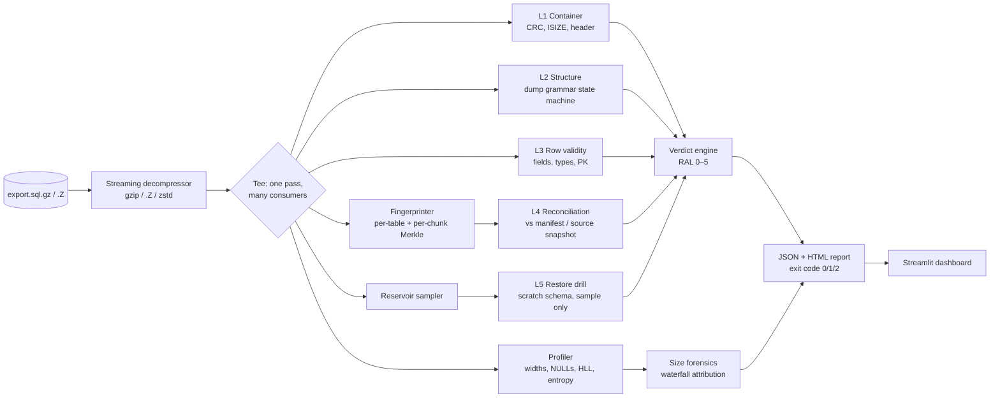

# ExportGuard — Implementation Plan

## 1. Problem restated as engineering requirements

| Constraint in the problem statement | Requirement it creates |
|---|---|
| Rows +30 %, compressed size −20 % | **R1** Explain the size change quantitatively, not with a guess |
| Management doubts usability for recovery | **R2** Give a defensible verdict on restorability, with evidence |
| File compressed by a Unix utility *while* export runs (pipe) | **R3** Detect failures a pipe hides (exporter dies, compressor finishes cleanly) |
| Table is very large; no time to re-import | **R4** Single streaming pass, bounded memory, runtime ≈ decompression time |
| No tablespace for a scratch import | **R5** Zero full restore; at most a tiny sampled restore (KBs–MBs) |
| (Implied) it will happen again | **R6** Prevent it: a hardened export pipeline that emits a manifest |

Two operating modes follow from this:

- **Forensic mode** — a legacy export already exists, no manifest. Max achievable verdict is usually
  *VERIFIED (RAL 4)* if source reconciliation is possible, otherwise *SUSPECT*.
- **Assured mode** — the export was produced by ExportGuard's hardened pipeline, which captured a
  manifest (counts + fingerprints in the same DB snapshot). Can reach *VERIFIED (RAL 5)*.

---

## 2. Why a file can legitimately shrink while rows grow

Compressed size decomposes exactly:

```
S  =  R  ×  W  ÷  C
       │     │     └─ compression ratio (raw bytes / compressed bytes)
       │     └─────── average raw bytes per row in the dump
       └───────────── rows
```

So `ln(S2/S1) = ln(R2/R1) + ln(W2/W1) − ln(C2/C1)`. For the incident: `0.80 = 1.30 × (W2/W1) ÷ (C2/C1)`,
i.e. the *per-row compressed cost* fell by ~38 %. Candidate causes ExportGuard tests one by one:

| Hypothesis | Evidence ExportGuard collects |
|---|---|
| **H1 Compressor changed** (`compress` → `gzip`, `gzip -1` → `-9`, gzip → pigz) | magic bytes (`1F 9D` vs `1F 8B`), gzip XFL flag (2 = max, 4 = fastest), `.Z` max-bits byte, **re-compress probe** at a fixed level |
| **H2 Rows got narrower** (column purged/NULLed, LOB moved out, shorter codes) | per-column average width & NULL fraction, v1 vs v2 |
| **H3 Data got more repetitive** (new rows dominated by defaults, low-cardinality values, sorted order) | per-column distinct estimate (HyperLogLog), byte entropy, compressibility per table section |
| **H4 Export parameters changed** (indexes/grants/stats excluded, LOBs skipped, charset change) | dump header & DDL section diff, export log diff |
| **H5 The file is incomplete** ← the dangerous one | Layers L1–L5 below |

H1–H4 are benign; H5 is not. **The tool's job is to rule H5 in or out and attribute the rest to H1–H4.**

---

## 3. Architecture



Design principles:
- **One decompression pass** feeds every consumer (generator/observer pattern). Never write the
  decompressed file to disk (that would violate R5).
- **Bounded memory**: everything is streaming or sketch-based (HyperLogLog, reservoir, rolling hashes).
  PK uniqueness uses an in-memory set below a threshold and a Bloom filter + spill above it.
- **Every check returns evidence**, not just a boolean: `CheckResult(layer, name, status, severity, evidence: dict, message)`.
- **Database-agnostic core**, dialect-specific parsers. PostgreSQL plain-format dumps for the
  simulation; Oracle mapping documented in `docs/ORACLE_PRODUCTION_RUNBOOK.md`.

---

## 4. The five integrity layers — algorithms

### L1 — Container integrity
- **gzip**: parse header (magic, CM, FLG, MTIME, XFL, OS, FNAME); stream-inflate with `zlib.decompressobj(wbits=31)`
  handling **multi-member** files (pigz/concatenation); verify CRC32 and ISIZE (note ISIZE is mod 2³² —
  compare against the streamed byte count mod 2³²); detect **trailing garbage** and **unexpected EOF**.
- **`.Z` (Unix compress)**: validate magic `1F 9D` and max-bits byte; decompress via `gzip -dc`
  subprocess (gzip can read `.Z`). Flag explicitly: *"container has no checksum — L1 cannot vouch
  for content; higher layers required"*. This is a teaching moment in the demo.
- Output: compressor, level hint, compressed bytes, uncompressed bytes, ratio, header mtime.

### L2 — Structural integrity (dump grammar)
A state machine over the decompressed lines of a PostgreSQL plain dump:
`PREAMBLE → (DDL | COPY_HEADER → COPY_ROWS → COPY_TERMINATOR "\.")* → POSTAMBLE → COMPLETE_MARKER`
- Required: `-- PostgreSQL database dump` header, every `COPY ... FROM stdin;` closed by `\.`,
  final `-- PostgreSQL database dump complete`.
- Failure examples: stream ends inside `COPY_ROWS` (exporter killed); completion marker missing;
  COPY block for an expected table absent.
- Records per table: rows seen, first/last line offsets, bytes.

### L3 — Row-level validity (every row, not sampled)
- Field count equals the column count from the `COPY` header.
- Type parse per column using the DDL in the dump (`integer`, `bigint`, `numeric`, `timestamp[tz]`,
  `date`, `boolean`, `jsonb` (valid JSON), `text` (valid UTF-8, valid COPY escapes)).
- Primary-key uniqueness (and not-NULL) — catches duplicated chunks from a bad retry.
- Errors are counted with the first N examples kept as evidence (line number, table, reason).

### L4 — Reconciliation (completeness & content)
**Row fingerprint:** `h(row) = first 8 bytes of BLAKE2b(raw COPY line bytes)` as `uint64`.
**Table fingerprint:** `(count, Σh mod 2⁶⁴, ⊕h)` — order-independent, so it is robust to row order.
**Chunk Merkle:** every 100 000 rows in stream order → chunk hash; table root = hash of chunk hashes.
A mismatch is localised to a chunk (≈ a row range), which the report shows.

Sources of truth, best first:
1. **Manifest** written at export time by the hardened pipeline (assured mode) — compares the file
   with exactly what the exporter emitted. Catches compression/transport/storage damage.
2. **Source snapshot counts** — the hardened pipeline opens a `REPEATABLE READ` transaction, calls
   `pg_export_snapshot()`, runs `pg_dump --snapshot=<id>` *and* `SELECT count(*)` in that same
   snapshot. Counts must match **exactly** — this catches the exporter itself dropping rows.
3. **Forensic mode** — no manifest: compare against current `count(*)` with a tolerance derived from
   table activity (`pg_stat_user_tables.n_tup_ins/n_tup_del` deltas), reported as *SUSPECT* if it
   cannot be made exact.

### L5 — Statistical restore drill (no tablespace)
- Reservoir-sample `n` rows during the same pass. Sample size from the detection-probability formula:
  `n = ⌈ln(α) / ln(1 − p)⌉` → for *p* = 0.1 % damaged rows and 95 % confidence, **n = 2 995**.
- Restore: create a scratch schema, apply only the table DDL from the dump, insert the sample
  (a few MB at most), then compare each sampled row to the source **by primary key** (in the export
  snapshot if available; otherwise treat differences in mutable columns as *drift*, not corruption).
- Drop the scratch schema. Report the confidence statement in plain English:
  *"If ≥ 0.1 % of rows were unrestorable, this drill would have caught it with 95 % probability."*

### Verdict engine
- `CORRUPT` if any critical check FAILs (L1 CRC/EOF, L2 incomplete, L3 error rate > 0, L4 mismatch,
  L5 mismatch).
- `SUSPECT` if no FAIL but a layer was skipped or only approximate (forensic tolerance, `.Z` with no
  manifest, sample drift).
- `VERIFIED` otherwise. **RAL** = number of layers that passed with full evidence (0–5).
- Thresholds live in `config/policy.yaml`, never hard-coded — and tests must not edit them to pass.

---

## 5. Size-anomaly forensics (`eguard explain v1 v2`)

1. Profile both exports in one streaming pass each: rows, raw bytes, per-column avg width,
   NULL fraction, HLL distinct count, byte entropy (Shannon, bits/byte), per-table compressed-cost
   estimate (re-compressing each table section independently at a fixed level).
2. **Re-compress probe**: take an identical-size sample from each decompressed stream (e.g. 64 MB),
   compress both with the *same* compressor and level. If the ratio gap disappears → H1
   (compressor/level changed). If it persists → the data itself changed (H2/H3).
3. **Waterfall attribution** of the −20 %: contribution of rows (+), row width (−), compressibility (−).
4. **Column drill-down**: rank columns by contribution to `ΔW` and `Δentropy`.
5. Plain-English narrative auto-generated from the numbers, e.g. (illustrative values — yours come
   from the measured run, and must satisfy `1.30 × 0.72 ÷ 1.18 ≈ 0.80`):
   *"Rows +30.0 %. Average row narrowed from 312 B to 225 B (−27.9 %), driven by `remarks`
   (NULL fraction 0 % → 77 %). Compression ratio 3.4× → 4.0× (+17.6 %). Net file size −20.4 %.
   No integrity layer failed: the shrink is explained by data shape, not data loss."*

---

## 6. The simulation (how we reproduce the incident honestly)

**Table** `transactions(id bigint PK, account_id int, txn_ts timestamptz, amount numeric(12,2),
currency char(3), status text, channel text, merchant_code text, remarks text, meta jsonb)`

- `remarks`/`meta` are high-entropy free text (≈ 200 B/row) — the expensive-to-compress part.
- Generated **inside PostgreSQL** with `generate_series` + `md5(random()::text)` (fast; millions of rows in seconds).

**Incident storyline** (all parameters in `config/sim.yaml`; calibrate until the numbers match):
1. Seed **N** rows (default 1 000 000; `--scale` for bigger) → **export v1** with the *legacy* pipeline
   (`pg_dump | gzip > v1.sql.gz`).
2. Business event: a data-privacy job **NULLs `remarks` and trims `meta`** for rows older than a cut-off;
   a new app release inserts **+30 %** rows whose `remarks` is NULL and `status/channel` are low-cardinality.
3. **Export v2** with the same legacy pipeline → +30 % rows, ≈ −20 % file size. *This is the incident.*

**Fault-injection gallery** (`sim/faults.py`), each a separate export file:

| ID | Fault | How it is produced | Expected result |
|---|---|---|---|
| F0 | None (v2 itself) | legacy pipeline | VERIFIED (forensic: SUSPECT→VERIFIED with source counts) |
| F1 | Exporter killed mid-stream, gzip finishes cleanly | `timeout` / `pg_terminate_backend` on `pg_dump` inside `pg_dump \| gzip` | **`gzip -t` = OK**, L2 + L4 = **CORRUPT** |
| F2 | File truncated at rest (disk full, copy interrupted) | `head -c 70%` of the `.gz` | L1 CORRUPT (unexpected EOF) |
| F3 | Single bit flip in a gzip file | flip one byte mid-file | L1 CORRUPT (CRC / inflate error) |
| F4 | Single bit flip in a `.Z` file | `compress` export, flip one byte | **L1 cannot detect**; L3/L4 CORRUPT |
| F5 | Silent value corruption, valid container | decompress → alter one amount → recompress | L1–L3 pass; **L4 fingerprint CORRUPT, chunk localised** |
| F6 | Duplicated chunk (bad retry/append) | repeat 10 000 COPY lines | L3 PK duplicate → CORRUPT |
| F7 | Compressor change only | same data, `gzip -1` vs `gzip -9` / `compress` vs `gzip` | VERIFIED; `explain` attributes size change to H1 |

The **defence-in-depth matrix** (fault × layer, ✔ = caught) is the centrepiece of the demo.

---

## 7. Hardened export pipeline (prevention — R6)

`scripts/export_with_manifest.sh` (wrapped by `eguard export`):

```bash
set -euo pipefail                          # a failing exporter can no longer hide behind gzip
# 1. open snapshot (psql session kept alive)  -> SNAP_ID, COUNT(*) per table in that snapshot
# 2. pg_dump --snapshot=$SNAP_ID ... \
#      | tee >(eguard manifest-build --out v3.manifest.json) \
#      | pigz -6 > v3.sql.gz
# 3. check PIPESTATUS for every stage; any non-zero -> mark export FAILED, keep file quarantined
# 4. sha256 of the .gz recorded in the manifest; manifest stored separately from the dump
# 5. immediately run: eguard verify v3.sql.gz --manifest v3.manifest.json
```

Manifest (JSON): tool versions, snapshot id/time, compressor+level, per-table `{count_db, count_stream,
sum64, xor64, chunk_roots[]}`, uncompressed sha256, compressed sha256, and an HMAC signature
(key from env) so a tampered manifest is detected.

---

## 8. Repository layout

```
export-integrity-verifier/
├── README.md
├── IMPLEMENTATION_PLAN.md          # this file
├── pyproject.toml                  # package + deps + console script `eguard`
├── Makefile                        # up, seed, incident, faults, verify-all, dashboard, test, bench
├── docker-compose.yml              # postgres:16 (+ optional scratch db for L5)
├── .env.example                    # PG_DSN, SCRATCH_DSN, MANIFEST_HMAC_KEY
├── config/
│   ├── policy.yaml                 # verdict thresholds, sample confidence, chunk size
│   └── sim.yaml                    # rows, growth %, purge cut-off, fault parameters
├── src/eguard/
│   ├── cli.py                      # Typer app: verify, explain, export, manifest-build, bench
│   ├── models.py                   # CheckResult, LayerReport, Verdict, Manifest (pydantic)
│   ├── stream.py                   # streaming decompressors + tee/fan-out
│   ├── container.py                # L1
│   ├── parsers/pg_plain.py         # dump grammar state machine, COPY decoding
│   ├── structure.py                # L2
│   ├── rows.py                     # L3 type validators, PK uniqueness (set → Bloom)
│   ├── fingerprint.py              # row hash, table sums, chunk Merkle
│   ├── manifest.py                 # build / sign / load / compare
│   ├── reconcile.py                # L4 vs manifest and vs source snapshot
│   ├── sampler.py                  # reservoir sampling, sample-size math
│   ├── restore_drill.py            # L5 scratch schema restore + PK compare
│   ├── profile.py                  # widths, NULLs, HLL, entropy
│   ├── forensics.py                # explain: decomposition, re-compress probe, narrative
│   ├── verdict.py                  # policy → verdict + RAL
│   └── report/{html.py, templates/report.html.j2}
├── dashboard/app.py                # Streamlit: verdict cards, matrix, waterfall, drill-down
├── sim/
│   ├── seed.sql                    # table DDL + generate_series loader
│   ├── incident.py                 # v1 → business change → v2
│   └── faults.py                   # F1–F7 generators
├── scripts/
│   ├── legacy_export.sh            # the naive `pg_dump | gzip` (reproduces the problem)
│   └── export_with_manifest.sh     # the hardened pipeline
├── tests/                          # pytest: unit per layer + end-to-end fault matrix
├── bench/                          # throughput/memory benchmark, results.md
├── docs/                           # demo script, Oracle runbook, slides/
└── data/                           # (git-ignored) exports/, manifests/, reports/
```

---

## 9. Phased delivery plan

Each phase ends with passing tests and a git commit/tag. Durations assume ~3–4 focused weeks; compress
as needed — phases 1–6 are the core, 7–8 are what make it stand out.

| Phase | Deliverable | Acceptance criteria |
|---|---|---|
| **0. Setup** (½ day) | repo skeleton, Docker Postgres, `pyproject`, Makefile, CI-able `make test` | `make up && make test` green on a clean clone |
| **1. Simulation** (1–2 days) | `seed.sql`, `incident.py`, `legacy_export.sh` | v2 has +30 % ± 1 % rows and −20 % ± 3 % size vs v1, reproducibly (fixed seed) |
| **2. Streaming core + L1** (2 days) | `stream.py`, `container.py` | detects F2, F3; multi-member gzip OK; memory flat on 1 GB input |
| **3. L2 + L3** (2–3 days) | parser, structure, rows | detects F1, F6; zero false positives on v1/v2 |
| **4. Fingerprints + manifest + L4** (2–3 days) | hardened export, manifest, reconcile | detects F4, F5 and reports the damaged chunk; snapshot counts exact |
| **5. L5 restore drill** (1–2 days) | sampler, scratch restore, confidence statement | sample size matches formula; scratch schema always dropped |
| **6. Verdict + reports** (1–2 days) | policy, JSON, HTML report, exit codes | full fault matrix test passes end-to-end |
| **7. Forensics `explain`** (2 days) | profile, re-compress probe, waterfall, narrative | attributes v1→v2 to row-width/compressibility; F7 to compressor |
| **8. Dashboard + benchmark + polish** (2–3 days) | Streamlit app, `bench/results.md`, slides | demo runs end-to-end from `make demo` in < 5 min on a laptop |

---

## 10. Testing strategy
- **Unit**: each layer with tiny hand-crafted fixtures (a 20-line dump, a truncated gzip, a 1-byte flip).
- **Property-based** (`hypothesis`): fingerprint is order-independent; any single-row change changes it.
- **End-to-end fault matrix**: `tests/test_fault_matrix.py` generates F0–F7 at small scale and asserts
  the exact verdict and the exact layer(s) that fail. This test *is* the demo's truth table.
- **No-false-positive test**: v1 and v2 must both be VERIFIED — the incident file is healthy.
- **Benchmark** (not a test): MB/s and peak RSS at 1×, 5×, 10× scale; compare with a timed full
  re-import (`psql < dump`) once at small scale to quote a honest speed/space ratio.

## 11. Stretch goals (only after phase 8)
- Parallel verification with `pigz -d` / zstd seekable frames; per-chunk workers.
- Prometheus textfile metrics + Grafana panel ("last verified export age", "RAL").
- Oracle adapter: parse `exp` log + `imp SHOW=Y` output; `ORA_HASH` source fingerprints (see runbook).
- MySQL `mysqldump` parser to show the core is dialect-agnostic.

## 12. Risks & honest limitations (say these out loud — judges respect it)
- Forensic mode on a live, changing table cannot be exact; the tool says *SUSPECT* rather than guess.
- Proprietary binary formats (Oracle Data Pump) cannot be parsed row-by-row; the manifest-at-source
  approach plus sampled `impdp QUERY=` restores is the substitute.
- 64-bit fingerprints have a ~2⁻⁶⁴ accidental-collision chance per comparison; they are integrity
  checks, not anti-tamper — the HMAC-signed manifest covers tampering.
